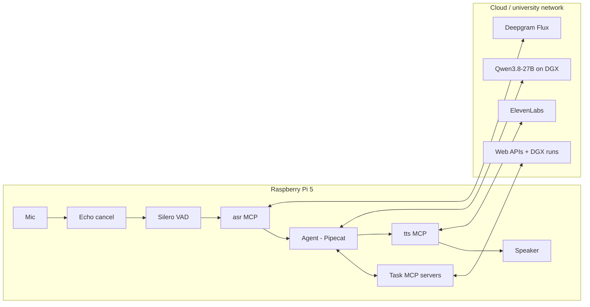
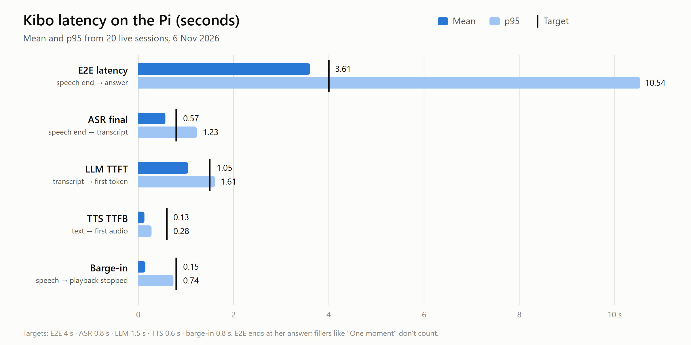

# ME 3 - Full-Duplex Voice AI Agent

**Kibo**, a voice agent on a Raspberry Pi 5. Talk to Kibo like a person in the room: no wake word, no push-to-talk. Kibo:

- **answers out loud**, in short sentences
- **shows long answers on screen**
- **stops when you interrupt it**
- **keeps long jobs running** (a website, a model on the DGX) while you ask other things

*AI 231 Machine Exercise. Sections follow the course template.*

## What it's built with

| Part | Used |
|---|---|
| **Device** | Raspberry Pi 5 |
| **Harness** | Pipecat 1.12 (Python) with an MCP client |
| **ASR (speech-to-text)** | Deepgram Flux, streaming, through Kibo's own `asr` MCP server |
| **TTS (text-to-speech)** | ElevenLabs Flash v2.5, streaming, through Kibo's own `tts` MCP server |
| **LLM** | Qwen3.8-27B, served with vLLM on the university DGX (2 servers) |
| **VAD** | Silero VAD, on the Pi (16 kHz mono) |
| **Echo cancellation** | PipeWire WebRTC echo canceller, on the Pi |
| **Tools** | MCP servers written for Kibo, all running on the Pi |
| **Audio** | USB microphone + USB speaker |

---

## 1. System diagram



**Flow:** voice in → VAD → ASR → LLM + tools → TTS → voice out

**Barge-in:** you speak → playback stops, LLM stream cut → Kibo listens

| On the Pi | In the cloud |
|---|---|
| Mic, echo cancel, VAD, agent, all MCP servers | Speech-to-text, text-to-speech, LLM, DGX jobs |

---

## 2. Prompt

Stored in `agent/persona.py`, versioned with git tags (`checkpoint-12` to `checkpoint-17`).

```text
You are Kibo, a friendly voice assistant on a Raspberry Pi, talking out loud
with one person in the same room. Warm, upbeat, natural.

- Keep it short: one or two sentences per turn.
- If the user starts speaking, stop and listen.
- Always reply at once; if something takes time, say so ("One moment, getting that now.").
- "Show me" puts it on the screen ("There you go."); "tell me" says it out loud.
- Never read URLs, code or markdown aloud; put them on the screen.
- Saying is not doing: if you say you're checking or sending something, call the tool.
- Long jobs (training on the DGX, building a website) run in the background;
  keep answering other questions meanwhile.
- Confirm before anything that can't be undone, like deleting.
- If you didn't catch it, ask briefly: "Sorry, say that again?"
```

**Rules Kibo always follows:**

| Rule | Example |
|---|---|
| Always reply at once | "One moment, getting that now." |
| "Show me" → screen | Page goes up, "There you go." |
| "Tell me" → spoken | Answer read out, nothing on screen |
| Never read URLs or markdown | Links go on screen |
| Confirm before deleting | "Delete Dentist tomorrow at 9 AM?" |

---

## 3. Context engineering

| Goes in | How it's managed |
|---|---|
| System prompt + persona | Stable part first, so the server answers faster |
| Your words (ASR finals) | Only the tools a turn needs are sent (20–50 of 113) |
| Turn events (barge-in, "mm-hm") | Old pages and scripts trimmed before each request |
| Tool results | A cut-off reply is kept as the words you actually heard |
| Memory + past code errors | Tokens and first-token time logged on every request |

---

## 4. MCP services and model serving

| Component | MCP server | Model | Where |
|---|---|---|---|
| ASR | `asr` | Deepgram Flux | Pi server, streaming |
| TTS | `tts` | ElevenLabs Flash v2.5 | Pi server, stops on barge-in |
| LLM | Pipecat MCP client | Qwen3.8-27B (vLLM) | 2 DGX servers, least busy one |
| VAD | in-process | Silero VAD | Pi, 16 kHz mono |
| DGX code | `files` | Qwen | Writes and runs code on the DGX |
| Websites and apps | `apps` | Qwen | Builds pages, publishes to GitHub Pages |
| Web and media | `tools` | Web APIs | Search, pictures, weather, cinema |
| Flights | `flights` | Fare APIs | Cheapest, earliest, status |
| Chemistry | `pubchem`, `rcsb` | PubChem, RCSB | Properties, structures, SDF/PDB files |
| Everyday | `calendar`, `timers`, `spotify`, `lights`, `telegram` | APIs | Events, alarms, music, lights, messages |

---

## 5. Evaluation and benchmark

**Method:** one clock on the Pi, a timestamp at every stage. 20 live sessions, 6 Nov 2026.

| Metric | Measures | Target | Mean | p95 |
|---|---|---|---|---|
| E2E latency | end of speech → answer | ≤ 4 s | **3.61 s** ✅ | 10.54 s |
| ASR final | end of speech → transcript | ≤ 0.8 s | **0.57 s** ✅ | 1.23 s |
| LLM TTFT | transcript → first token | ≤ 1.5 s | **1.05 s** ✅ | 1.61 s |
| TTS TTFB | text → first audio | ≤ 0.6 s | **0.13 s** ✅ | 0.28 s |
| Barge-in | you speak → Kibo stops | ≤ 0.8 s | **0.15 s** ✅ | 0.74 s |
| WER | ASR accuracy | — | not measured | — |



**Full-Duplex-Bench** (1 Nov 2026, [full results](benchmark/fd_bench_best.md)):

| Test | Score |
|---|---|
| Answers when it's her turn | 3 / 3 |
| Waits through a pause | 3 / 3 |
| Stops when interrupted | 3 / 3 |
| Stays quiet when not spoken to | 4 / 6 |

---

## Demo

| # | You say | Kibo |
|---|---|---|
| 1 | "Make a Christmas snake game app." | "Okay, building that right now." (builds in the background) |
| 2 | "While you're doing that, train an MNIST classifier on the DGX." | "On it, writing the code now." (runs on the DGX) |
| 3 | "What are you building?" | "The code for the DGX run and the snake app." |
| 4 | "What movies are showing in TriNoma?" | "7 films at TriNoma today, next at 12:00 PM." |
| 5 | "What's the cheapest flight to Cebu tomorrow?" | "Cebu Pacific 5J2515, 2:45 AM, 5,159 pesos." |
| 6 | "Make a website about Mark Andrian Macalalad and publish it on github.io." | Live at [markandrian30.github.io/mark-andrian-macalalad](https://markandrian30.github.io/mark-andrian-macalalad/) |

**When something is slow:**
- **DGX run:** a spoken update every 30 s ("Still running on the DGX.")
- **Web search over 12 s:** Kibo answers from what it already knows, and says so

---

## Results: sample questions

Live sessions, 7 Nov 2026:

| You asked | Kibo answered | Time |
|---|---|---|
| Cheapest flight to Cebu tomorrow | "Cebu Pacific 5J2515, nonstop at 2:45 AM for 5,159 pesos." | ~2 s |
| Movies at TriNoma today | "7 films at TriNoma Cinema today, next at 12:00 PM." | ~2.5 s |
| Train MNIST on the DGX, 10 sample predictions | Code written in 12 s, ran OK, results page shown | ~1.5 min |
| Can that compound inhibit SGLT2? | "Honest answer: no direct evidence. PubChem has no recorded SGLT2 assay…" | ~12 s |
| Show me empagliflozin's properties | PubChem properties page, "There you go." | ~7 s |
| Website about Mark Andrian Macalalad on github.io | Built and published | ~1 min |

**Setup:** Raspberry Pi 5 · USB mic + speaker · Pipecat 1.12 · Qwen3.8-27B · Deepgram Flux · ElevenLabs · Silero VAD · 65 automated tests before every change

---

## Challenges and fixes

| Problem | Fix | Result |
|---|---|---|
| New questions cut the DGX code, so it never finished | Code is written in the background (`dgx_job`) | Code written in 12 s while questions continued |
| Kibo stopped mid-sentence, copying a "[cut off]" note | Note moved and stripped before speech | Full sentences again |
| Kibo's own voice was heard as the user | Echo canceller + echo guard | Barge-in 0.15 s |
| DGX login refused on campus Wi-Fi | Falls back to the laptop relay | DGX run OK |
| "Tell me" answers went on screen | Your newest words decide | Spoken when asked |
| Simple questions took two LLM passes | Flights, movies, calendar answered directly | ~2 s instead of ~6 s |

---

## References

- [Model Context Protocol](https://modelcontextprotocol.io)
- [Pipecat](https://docs.pipecat.ai)
- [Silero VAD](https://github.com/snakers4/silero-vad)
- Full-Duplex-Bench (course benchmark)
- Deepgram, ElevenLabs, vLLM, PubChem, RCSB PDB
